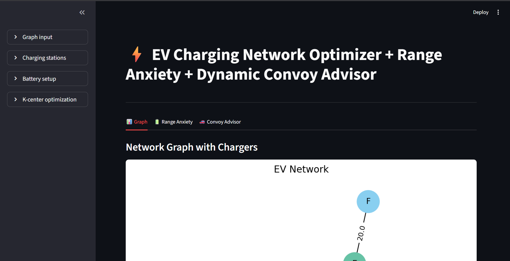

# ⚡ EV Charging Network Optimizer + Dynamic Convoy Advisor

A full-stack **Streamlit** application designed to optimize electric vehicle (EV) charging networks, plan battery-safe routes, and provide dynamic convoy advice for EV drivers.

---

## 🚀 Key Features

1. **Topology & Network Visualization**
   - Define custom road graphs by specifying weighted edges (`u v distance`).
   - Visually renders network nodes, edge distances, existing charging stations, and optimized new locations using NetworkX and Matplotlib.

2. **K-Center Optimization (Facility Location)**
   - Computes the optimal locations for $K$ new charging stations to cover charging deserts.
   - Minimizes the maximum distance any network node has to the nearest charging station using a greedy 2-approximation algorithm.

3. **Battery-Safe Routing (Range Anxiety Resolution)**
   - Determines the shortest feasible route between any source and destination ensuring the battery never drains to zero.
   - Automatically schedules recharge stops at available charging stations.
   - Computes distance metrics and average distance per recharge stop.

4. **Dynamic Convoy Advisor**
   - Real-time decision advisor for convoys or drivers approaching intermediate stations along a route.
   - Accounts for real-time queue lengths, station capacity (plugs), charging speed, and distance to the next station to decide whether to charge or skip.

---

## 📸 Demo Preview



---

## 🧠 Algorithms & Technical Details

| Module | Algorithm / Technique | Complexity | Description |
|---|---|---|---|
| **Graph Construction** | Adjacency List (`networkx.Graph`) | $O(V + E)$ | Parses input graph edges and distances into an undirected weighted graph. |
| **K-Center Placement** | Farthest-First Greedy 2-Approximation | $O(K \cdot V \cdot (V + E \log V))$ | Iteratively selects the vertex farthest from the current set of centers. |
| **Safe Route Planning** | State-Space Priority Queue (Dijkstra) | $O((V \cdot B + E) \log(V \cdot B))$ | Explores states `(node, battery)` to guarantee battery constraints are strictly satisfied. |
| **Convoy Advisor** | Deterministic Queue Wait-Time Heuristic | $O(1)$ per station | Evaluates `Wait Time = (Queue / Capacity) * Charge Time` against battery feasibility. |

---

## 💻 Local Setup & Installation

### 1. Clone the repository
```bash
git clone https://github.com/naren1308/EV-Charging-Network-Optimizer-Range-Anxiety-Dynamic-Convoy-Advisor.git
cd EV-Charging-Network-Optimizer-Range-Anxiety-Dynamic-Convoy-Advisor
```

### 2. Create a virtual environment & install dependencies
```bash
python -m venv venv
# On Windows:
.\venv\Scripts\activate
# On Linux/macOS:
source venv/bin/activate

pip install -r requirements.txt
```

### 3. Run the Streamlit application
```bash
streamlit run app.py
```

---

## 🤗 Hugging Face Spaces Deployment

This repository is pre-configured for direct deployment on **Hugging Face Spaces**:
- **SDK**: Streamlit
- **Entry point**: `app.py`
- **Dependencies**: Specified in `requirements.txt`
- **Metadata**: Pre-configured in the YAML frontmatter of `README.md`
